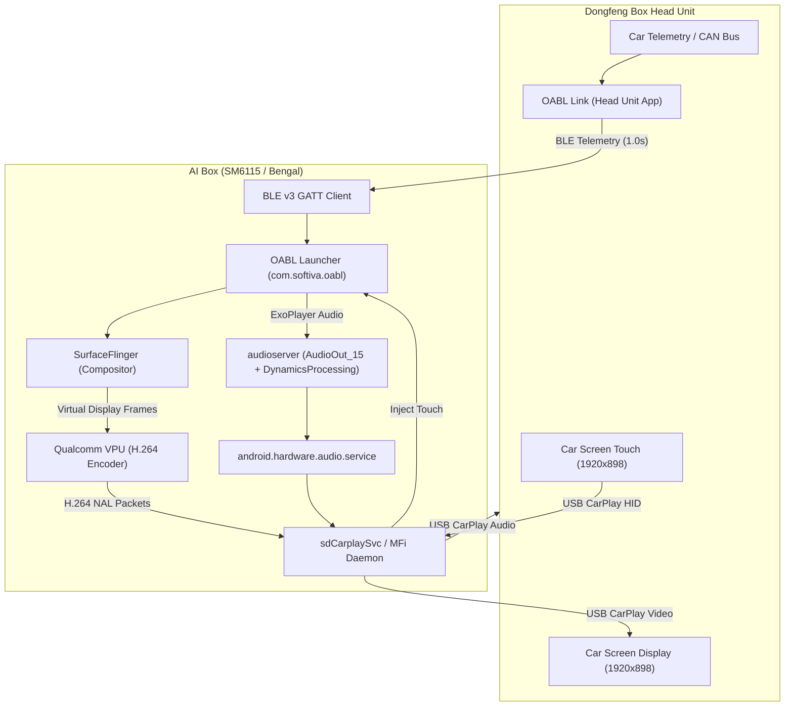
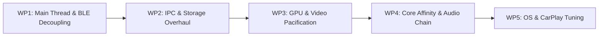

# Open AI Box Launcher (OABL) — SM6115 (Bengal) Android 13 Optimization Specification

> **Target Vehicle:** Dongfeng Box (Dongfeng Nammi 01 EV)  
> **Head Unit Display:** 1920 × 898 at 238 dpi, about 1291 × 604 dp (the box's live display, checked 4 November; the emulator AVD's 1920 × 970 is not the car) (Wired / Wireless Apple CarPlay interface)  
> **AI Box Hardware:** Qualcomm Snapdragon 662 (SM6115 / Bengal), 4 GB LPDDR4x RAM, 64 GB eMMC 5.1  
> **OS:** Android 13 (API 33)  
> **Telemetry:** OABL Link on Head Unit transmitting vehicle CAN/telemetry over BLE v3 (J-PAKE authenticated, AES-256-GCM encrypted)

---

## 1. System Architecture & Root Cause of Lag

The AI Box connects to the Dongfeng Box head unit via an MFi hardware interface. It translates Android into Apple CarPlay by capturing the Android virtual display, encoding it with the Qualcomm hardware H.264 encoder (`OMX.qcom.video.encoder.avc`), and streaming it over USB to the car. Touches on the car screen travel back over USB to `sdCarplaySvc` and are injected into Android via `system_server`.



### Why the System Lags
1. **Continuous H.264 Video Encoding Saturation:** On this hardware, invalidating a View does not simply update a physical screen—it forces SurfaceFlinger to re-composite and the Qualcomm hardware encoder to encode a 1920×898 frame. Continuous UI animations (speed needle `ValueAnimator`, spectrum analyzer, pulsing icons) force the encoder to run at 100% duty cycle. This saturates the shared memory bus (~14.9 GB/s) and fills the USB transmission queue, creating high touch-to-photon latency.
2. **Qualcomm `core_ctl` & Thermal Throttling:** SM6115 has 4× Cortex-A73 Big cores (Cores 4–7 @ 2.0 GHz) and 4× Cortex-A53 Little cores (Cores 0–3 @ 1.8 GHz). In an enclosed automotive dashboard, continuous CPU/VPU encoding pushes die temperatures past 70–75 °C. The kernel thermal engine and `core_ctl` park or downclock the Big cores, forcing the entire OS onto the weak A53 cores.
3. **Fragmented Audio Chain:** Audio playback crosses six processes. Stutter occurs when downstream processes (`audioserver`, HAL, `sdCarplaySvc`) get scheduled on Cortex-A53 cores or interrupted by UI garbage collection.

---

## 2. Actionable Implementation Work Packages

Agents implementing these improvements should execute the following five work packages in sequence.



---

### Work Package 1: Main Thread & BLE Decoupling

#### 1.1 Move BLE GATT Callbacks Off the UI Thread
- **Target File:** [BleGattClient.java](../oabl-link/bluetooth/src/main/java/com/softiva/oabllink/bluetooth/BleGattClient.java#L30)
- **Problem:** `callbacks` is initialized with `new Handler(Looper.getMainLooper())` and passed to `device.connectGatt(...)`. Characteristic changes, packet fragmentation, and frame assembly run directly on the UI thread, causing micro-stutters during 1 Hz car telemetry ingestion.
- **Action:**
  1. Create a dedicated background `HandlerThread("OablBleCallbacks")`.
  2. Initialize `callbacks = new Handler(bleThread.getLooper())`.
  3. Ensure `fragment(...)` and `incoming.accept(...)` execute exclusively on this thread before posting completed payloads to the telemetry worker.

#### 1.2 Eliminate Synchronous Sysfs Iteration on Main Thread
- **Target File:** [BoxThermal.java](../app/src/main/java/com/softiva/oabl/BoxThermal.java#L31-L42), invoked by [MainActivity.java](../app/src/main/java/com/softiva/oabl/MainActivity.java#L166).
- **Problem:** `BoxThermal.celsius()` opens and reads dozens of `thermal_zone*/temp` and `type` files synchronously on the Main Thread inside the 1.5-second `mediaRefresh` loop.
- **Action:**
  1. Identify the specific Qualcomm Bengal SoC temperature zone (typically `cpuss-2-usr`, `cpu-1-0-usr`, or `tsens_tz_sensor`).
  2. Cache the matched zone path after first discovery.
  3. Execute reads on a background single-thread executor; update a `volatile float currentTemperature` read by the UI.

#### 1.3 Asynchronous Artwork Box Blur
- **Target File:** [MainActivity.java](../app/src/main/java/com/softiva/oabl/MainActivity.java#L1480-L1496) and [ImageBlur.java](../app/src/main/java/com/softiva/oabl/ImageBlur.java#L11-L28).
- **Problem:** `ImageBlur.blurred` runs three passes of box blur on an allocated pixel array directly on the UI thread inside `renderMediaBackdrop`.
- **Action:**
  1. Move `ImageBlur.blurred(art, 48, 48, 4)` to the existing background executor in `MusicArt` or `WallpaperRenderer`.
  2. Hand the blurred `BitmapDrawable` back to the UI thread via `handler.post()`.

#### 1.4 Asynchronous App List & Icon Rasterization
- **Target File:** [InstalledAppsRepository.java](../app/src/main/java/com/softiva/oabl/InstalledAppsRepository.java#L28-L53) and [MainActivity.java](../app/src/main/java/com/softiva/oabl/MainActivity.java#L822-L828).
- **Problem:** `reloadApps()` calls `appRepository.load()` on the Main Thread upon resume, performing synchronous package queries and icon rasterization.
- **Action:**
  1. Load package labels and render icons into cache bitmaps on a worker thread.
  2. Deliver the sorted `List<AppEntry>` to the UI thread via callback.

---

### Work Package 2: In-App IPC & Storage Overhaul

#### 2.1 Replace File-Based Reflection IPC with In-Memory Binder IPC
- **Target Files:** [EnergyClient.java](../app/src/main/java/com/softiva/oabl/EnergyClient.java#L35-L55) and [HomeEnergySnapshot.java](../app/src/main/java/com/softiva/oabl/HomeEnergySnapshot.java#L24-L26).
- **Problem:** On every 1-second telemetry update, `EnergyClient.call(...)` creates temporary files on eMMC 5.1 (`request-UUID.bin` and `.reply`), serializes objects via Java `ObjectOutputStream`, and scans fields with reflection (`field.setAccessible(true)`). eMMC random write latency causes severe I/O stalls and flash wear.
- **Action:**
  1. Eliminate temporary file creation and Java Object streams.
  2. Make `HomeEnergySnapshot` implement standard Android `Parcelable` (or use `Bundle.putDouble/putString`).
  3. Transmit the snapshot across Binder using `ContentProvider.call(URI, "home.snapshot", null, bundle)` purely in memory.

#### 2.2 Enable SQLite Write-Ahead Logging (WAL)
- **Target File:** [EnergyStore.java](../app/src/main/java/com/softiva/oabl/EnergyStore.java#L40-L75).
- **Problem:** `energy.db` is opened simultaneously by `:energy` (read/write) and `com.softiva.oabl` (read-only) in rollback journal mode. Writes lock the entire file, blocking UI reads and triggering `database is locked` / `SQLITE_BUSY` errors.
- **Action:**
  1. Add `setWriteAheadLoggingEnabled(true)` in `EnergyStore` constructor / `onConfigure`.
  2. Set `db.enableWriteAheadLogging()`.
  3. Remove the redundant `EnergyClient.call(context, "ping")` round-trip inside `getReadableDatabase()`.

#### 2.3 In-Memory Reducer Caching
- **Target File:** [HomeEnergySnapshot.java](../app/src/main/java/com/softiva/oabl/HomeEnergySnapshot.java#L42-L53).
- **Problem:** `HomeEnergySnapshot.capture(...)` executes multi-table queries with `LEFT JOIN`, subqueries, and JSON string parsing on every 1-second tick.
- **Action:**
  1. Keep the active `latestDrive`, `unpricedCharges`, and `openCharge` in-memory inside `:energy` process.
  2. Update the in-memory cache incrementally when `repository.observe()` processes a new frame, avoiding full database queries on every poll.

---

### Work Package 3: Rendering, GPU & Video Encoder Pacification

#### 3.1 Damped / Discrete Updates for Speed Gauge
- **Target File:** [SpeedGaugeView.java](../app/src/main/java/com/softiva/oabl/SpeedGaugeView.java#L125-L138).
- **Problem:** `glideTo()` starts a 900 ms `ValueAnimator` every 1.0s (telemetry) and 500 ms (GPS). Every frame calls `invalidate()` and `setValueText()`, forcing the CarPlay H.264 hardware encoder to compress 1920×898 video non-stop.
- **Action:**
  1. Gate continuous animations behind `preferences.visualEffects()`.
  2. In automotive mode, apply discrete updates (1–2 Hz) or step changes directly without multi-frame interpolation.
  3. Avoid calling `valueText.setScaleX/Y()` when the numeric character width has not changed.

#### 3.2 Freeze / Throttle Music Spectrum While Driving
- **Target Files:** [HomeSpectrumView.java](../app/src/main/java/com/softiva/oabl/HomeSpectrumView.java#L118-L124) and [PlaybackSpectrum.java](../app/src/main/java/com/softiva/oabl/PlaybackSpectrum.java#L78).
- **Problem:** Runs a 15 fps redraw loop using `postDelayed(redraw, 66)`. Constant screen movement forces high H.264 bitrates and CPU load.
- **Action:**
  1. Ensure spectrum drawing automatically pauses when vehicle speed > 0 km/h or driving mode is active.
  2. When paused, hide the view completely (`View.INVISIBLE` / `View.GONE`) so SurfaceFlinger skips layer compositing.

#### 3.3 Flatten Layout Hierarchy in Main Dashboard
- **Target File:** [activity_main.xml](../app/src/main/res/layout/activity_main.xml#L27-L184).
- **Problem:** 6–7 levels of nested `LinearLayout`s with `layout_weight` cause $2^n$ measurement passes per layout cycle.
- **Action:**
  1. Flatten `instrument_strip` and `main_row` into a flat layout (or single-pass custom `ViewGroup`).
  2. Replace nested weights with fixed dimensions or single-tier constraints.

#### 3.4 Consolidate Drive Overlay Windows
- **Target File:** [DriveOverlayService.java](../app/src/main/java/com/softiva/oabl/DriveOverlayService.java#L38-L41).
- **Problem:** Spawns 4 separate `WindowManager` overlay surfaces (`clockCard`, `speedCard`, `homeCard`, `mediaCard`).
- **Action:**
  1. Combine into a single transparent full-screen overlay layout containing all floating cards.
  2. Reduces SurfaceFlinger composition layers from 5 to 2 when Google Maps is running.

#### 3.5 Eliminate Screen Overdraw
- **Target File:** [MainActivity.java](../app/src/main/java/com/softiva/oabl/MainActivity.java#L4349) and [activity_main.xml](../app/src/main/res/layout/activity_main.xml#L3-L5).
- **Action:**
  1. Set window background to null when wallpaper is drawn: `getWindow().setBackgroundDrawable(null)`.
  2. Merge `wallpaper_scrim` into the wallpaper Bitmap generation in `WallpaperRenderer` rather than compositing a separate full-screen View.

---

### Work Package 4: Core Affinity & Audio Chain Enforcement

To ensure zero audio dropouts and minimal UI latency, the entire processing chain must be pinned to the performance cores (Cores 4–7, mask `0xf0`).

```
Target CPU Topology (Snapdragon 662 / SM6115):
├── Cores 0-3 (Cortex-A53 Little Cores, 1.8 GHz) -> Background tasks, OS housekeeping, logging
└── Cores 4-7 (Cortex-A73 Big Cores, 2.0 GHz)   -> Audio, OABL UI, CarPlay VPU, SurfaceFlinger
```

#### 4.1 Expand Native Root Watcher Targets
- **Target File:** [scripts/oabl-affinity.c](../scripts/oabl-affinity.c#L111-L117).
- **Current Coverage:** `com.softiva.oabl`, `audioserver`, `android.hardware.audio.service`, `sdCarplaySvc`, `sd_carplay`, `media.codec`, `media.swcodec`, `carnetos.usbmedia`, Bluetooth.
- **Additions:**
  1. Add `surfaceflinger` to `target(name)` so display frame compositing never stalls waiting on Little cores.
  2. Ensure `com.softiva.oabl:music` and `com.softiva.oabl:services` remain explicitly matched.

#### 4.2 Fix Vendor Cpuset Configurations
- **Action:** On this firmware, vendor init sets `/dev/cpuset/audio-app/cpus` to `1-2`.
- **Enforcement Command:**
  ```bash
  echo 4-7 > /dev/cpuset/audio-app/cpus
  ```

#### 4.3 Prevent Core Parking in Qualcomm `core_ctl`
- **Problem:** Qualcomm's `core_ctl` kernel driver isolates Cores 4–7 during idle intervals. Subsequent thread wakeups suffer power-state transition delays.
- **Enforcement Command:**
  ```bash
  echo 2 > /sys/devices/system/cpu/cpu4/core_ctl/min_cpus
  ```
  *(Keeping at least 2 big cores online eliminates waking latency while avoiding excessive thermal generation).*

#### 4.4 Set Real-Time Priority (`SCHED_FIFO`) on Audio Loop
- **Action:** Elevate the critical audio mixer and keep-alive threads to `SCHED_FIFO` priority 2:
  ```bash
  # admin_open_play (prevents CarPlay audio capture collapse)
  chrt -f -p $(pidof admin_open_play) 2
  # Audio HAL writer threads
  for t in $(pidof android.hardware.audio.service); do
    for tid in /proc/$t/task/*; do
      [ "$(cat $tid/comm 2>/dev/null)" = "writer" ] && chrt -f -p ${tid##*/} 2
    done
  done
  # AudioFlinger mixer threads
  for t in $(pidof audioserver); do
    for tid in /proc/$t/task/*; do
      case "$(cat $tid/comm 2>/dev/null)" in AudioOut_*) chrt -f -p ${tid##*/} 2 ;; esac
    done
  done
  ```

---

### Work Package 5: Vendor CarPlay / Suding Configuration & AOT Compilation

#### 5.1 Cap CarPlay Reverse Video Frame Rate to 30 FPS
- **Problem:** Head unit advertises 60 fps to Suding. Encoding 1920×898 @ 60 fps on Adreno 610 / SM6115 VPU causes massive latency and thermal buildup.
- **Action:**
  Enforce frame interval 2 (halves encoding rate from 60 to 30 fps) and persist reverse FPS:
  ```bash
  setprop suding.carplay.reverse.video.frame.interval 2
  setprop persist.suding.reverse.fps 30
  ```

#### 5.2 Force Ahead-Of-Time (AOT) Dexopt Compilation
- **Problem:** Android 13 defaults to JIT compilation. On Cortex-A53 cores, JIT compilation spikes cause UI stutter.
- **Action:**
  Pre-compile OABL ahead of time:
  ```bash
  cmd package compile -m speed -f com.softiva.oabl
  ```

---

### Work Package 6: Automotive UI/UX Refinements for Dongfeng Box

1. **Touch Target Dimensions:** Ensure all interactive elements have a minimum touch bounding box of **56 dp × 56 dp** to account for vehicle vibration.
2. **Optimistic Touch Feedback:** Provide immediate visual feedback (`ACTION_DOWN` alpha/scale change) on the UI thread before delegating to async workers, masking the ~60–90 ms CarPlay USB round-trip latency.
3. **Typography Scaling:** Increase secondary metric text from 10–11 sp to **13–14 sp** for glanceability at typical in-cabin viewing distances (60–80 cm).
4. **GPS Polling Cadence:** In [SpeedTracker.java](../app/src/main/java/com/softiva/oabl/SpeedTracker.java#L50), adjust GPS update interval from 500 ms to **1000 ms**, and pause GPS speed calculations whenever live car wheel-speed is arriving over BLE.

---

## 3. Verification & Performance Validation Matrix

| Target Metric | Baseline (Current) | Target (Post-Optimization) | Verification Tool / Command |
| :--- | :--- | :--- | :--- |
| **Touch-to-Display Latency** | 200–350 ms | $\le$ 100 ms | High-speed video / CarPlay input latency log |
| **Audio Underruns (HAL)** | Frequent during UI load | **0 underruns / hour** | `scripts/audio-underruns.sh <ip:port> 1 20` |
| **H.264 Encoder FPS** | 60 fps (continuous load) | 30 fps (sleeps on static screen) | `dumpsys media.resource_manager` |
| **Main Thread Stall (Choreographer)** | 30–80 ms per tick | $\le$ 16 ms (zero dropped frames) | `adb shell dumpsys gfxinfo com.softiva.oabl` |
| **IPC Storage Latency** | 15–40 ms (eMMC file writes) | $\le$ 1 ms (in-memory Binder) | In-app trace / method profiling |
| **AI Box Operating Temp** | Throttling ($> 75\ ^\circ\text{C}$) | $\le 65\ ^\circ\text{C}$ steady-state | `cat /sys/class/thermal/thermal_zone*/temp` |
| **Cores Allowed (Audio Chain)** | 0–3 or 1–2 (Little cores) | **4–7 exclusively (mask `0xf0`)** | `scripts/placement-report.sh` |
